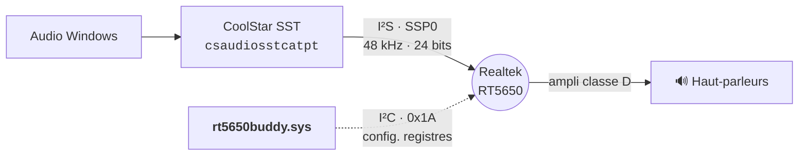

<div align="center">

# 🔊 rt5650-buddy

**Le son des haut-parleurs sous Windows sur l'Acer Chromebase 24**

Un pilote KMDF minimal qui configure en I²C le codec Realtek **RT5650** de la carte Google *BUDDY* (Broadwell).

[](https://github.com/itsbeko/rt5650-buddy/actions/workflows/build.yml)
[](LICENSE)
[](#-installation)
[](https://learn.microsoft.com/windows-hardware/drivers/wdf/)

[English](README.md) · **Français**

⚠️ **Nécessite le mode test de Windows :** voir [Installation](#-installation)

</div>

---

## 📖 Sommaire

- [Pourquoi](#-pourquoi)
- [Fonctionnement](#%EF%B8%8F-fonctionnement)
- [État](#-état)
- [Installation](#-installation)
- [Compilation](#%EF%B8%8F-compilation)
- [Dépannage](#-dépannage)
- [Désinstallation](#%EF%B8%8F-désinstallation)
- [Remerciements](#-remerciements)
- [Licence](#-licence)

## 💡 Pourquoi

Une fois Windows installé sur un Chromebase 24, le pilote CoolStar SST fait tourner le DSP audio Intel. Les haut-parleurs restent pourtant muets, parce que rien sous Windows ne configure le **codec RT5650** placé entre le DSP et les haut-parleurs. Ce pilote comble ce manque : à chaque mise sous tension du périphérique, il initialise le codec et ouvre le chemin vers les haut-parleurs.

## ⚙️ Fonctionnement



| Élément | Rôle | Pilote |
|---|---|---|
| DSP Intel SST (Broadwell, SSP0) | Transporte les échantillons en I²S | [CoolStar SST](https://coolstar.org/chromebook/windows-install.html), I²S *provider*, 2 canaux, MCLK 24 MHz |
| Realtek RT5650 (ACPI `10EC5650`, I²C `0x1A`) | CNA + ampli classe D des haut-parleurs | **rt5650buddy** |

`rt5650buddy` ne touche jamais aux données audio. À chaque **entrée en D0**, il exécute cette séquence d'init en I²C :

1. **Identification :** lit le registre `0xFF` et attend `0x6419`.
2. **Reset**, puis les séquences d'init du constructeur (registres privés).
3. **Polarisation :** OFF → STANDBY → ON.
4. **Horloges :** la PLL1 transforme la MCLK 24 MHz en ≈ 24,576 MHz, utilisée comme SYSCLK.
5. **I²S1 :** mode esclave, 24 bits, 48 kHz.
6. **Routage :** DAC L1/R1 → mixeur HP → SPKVOL → ampli classe D.

À la **sortie de D0**, il coupe l'ampli et mute les haut-parleurs.

Les valeurs de registres sont reprises des pilotes Linux [`rt5645.c`](https://github.com/torvalds/linux/blob/master/sound/soc/codecs/rt5645.c) (qui gère aussi le RT5650) et [`bdw-rt5650.c`](https://github.com/torvalds/linux/blob/master/sound/soc/intel/boards/bdw-rt5650.c).

## 📊 État

| Fonction | |
|---|:---:|
| Haut-parleurs internes | ✅ |
| Prise casque | ❌ |
| Détection jack | ❌ |
| Micro interne | ❌ |
| Volume matériel | ❌ *(fixe à ~0 dB, le volume Windows marche quand même)* |

## 📦 Installation

> [!CAUTION]
> **Windows DOIT être en mode test (`testsigning on`). Sans ça, le pilote ne se charge pas.**
>
> Le pilote est signé avec un **certificat de test**, pas par Microsoft. Hors mode test, Windows refuse de le charger et le périphérique affiche le **code 52** (« impossible de vérifier la signature numérique »). Il n'y a aucun contournement : pas de mode test, pas de son.
>
> - Le mode test ne peut s'activer que si le **Secure Boot est désactivé** dans le firmware.
> - Le filigrane *« Mode test »* s'affiche ensuite en bas à droite du bureau. C'est normal.
> - C'est du code noyau, tu l'utilises à tes risques.

**Prérequis :**

- le [pilote CoolStar SST](https://coolstar.org/chromebook/windows-install.html) est installé et son périphérique démarre sans erreur ;
- le **Secure Boot est désactivé** et le **mode test est activé** (étape 2).

**1. Télécharge** l'artefact `rt5650buddy` du [dernier build réussi](https://github.com/itsbeko/rt5650-buddy/actions/workflows/build.yml) et décompresse-le. Il contient `rt5650buddy.sys`, `.inf`, `.cat` et `pont-test.cer`.

**2. Active le mode test (obligatoire).** Lance ceci dans une invite administrateur, puis **redémarre** :

```powershell
bcdedit /set testsigning on
```

Après le redémarrage, vérifie que le filigrane *« Mode test »* apparaît sur le bureau. Si `bcdedit` répond *« La valeur est protégée par la stratégie de démarrage sécurisé »*, désactive d'abord le Secure Boot.

**3. Fais confiance au certificat de test.** Lance ceci dans un PowerShell administrateur :

```powershell
Import-Certificate -FilePath .\pont-test.cer -CertStoreLocation Cert:\LocalMachine\Root
Import-Certificate -FilePath .\pont-test.cer -CertStoreLocation Cert:\LocalMachine\TrustedPublisher
```

> [!NOTE]
> Chaque build de la CI génère un **nouveau** certificat. Importe le `.cer` livré avec le build que tu installes.

**4. Installe le pilote :**

```powershell
pnputil /add-driver .\rt5650buddy.inf /install
```

Les haut-parleurs devraient maintenant sortir du son. 🎉

## 🛠️ Compilation

<details>
<summary><b>Avec GitHub Actions</b> (recommandé)</summary>

<br>

Chaque push et chaque pull request lance [`build.yml`](.github/workflows/build.yml). Le workflow :

1. compile le pilote avec MSBuild sur `windows-2022` ;
2. génère un certificat de signature de code auto-signé ;
3. signe `rt5650buddy.sys`, puis génère et signe le catalogue `.cat` ;
4. publie le tout dans l'artefact `rt5650buddy`.

</details>

<details>
<summary><b>En local</b></summary>

<br>

Il faut Visual Studio 2022, le Windows SDK et le WDK.

```powershell
msbuild rt5650buddy.vcxproj /p:Configuration=Release /p:Platform=x64
```

La signature est désactivée dans le projet (`SignMode=Off`). Signe le résultat toi-même, ou reprends les étapes du workflow.

</details>

## 🩺 Dépannage

Le pilote écrit son résultat dans la clé de registre du périphérique. Pour le lire :

```powershell
Get-ItemProperty "HKLM:\SYSTEM\CurrentControlSet\Enum\ACPI\10EC5650\*\Device Parameters" |
  Select-Object @{n='DeviceId';e={'0x{0:X4}' -f $_.DeviceId}},
                @{n='InitStatus';e={'0x{0:X8}' -f $_.InitStatus}},
                InitStep
```

| `InitStep` | `InitStatus` | Signification |
|:---:|---|---|
| **37** | `0x00000000` | ✅ Tout va bien : le codec est entièrement configuré |
| *(aucune valeur)* | | Le pilote ne s'est jamais chargé. Le Gestionnaire de périphériques affiche le **code 52** : **le mode test n'est pas actif**, voir [Installation](#-installation), étape 2 |
| 0 | `0xC000009A` | Aucune ressource I²C dans l'ACPI (mauvais périphérique ou `_CRS` absent) |
| 0 | autre erreur | Impossible d'ouvrir le contrôleur I²C (le pilote Intel I²C / Serial IO est-il installé ?) |
| 1 | `0xC0000182` | La puce répond mais ce n'est pas un RT5650 (`DeviceId` ≠ `0x6419`) |
| 1 | autre erreur | Aucune réponse en I²C à l'adresse `0x1A` |
| 2–13 | erreur | Échec pendant le reset / les séquences d'init |
| 14–17 | erreur | Échec pendant la mise sous tension (polarisation) |
| 18–22 | erreur | Échec de configuration PLL / horloges |
| 23–24 | erreur | Échec de configuration de l'interface I²S |
| 25–29 | erreur | Échec sur l'alimentation / le routage numérique |
| 30–37 | erreur | Échec sur le chemin haut-parleurs / l'ampli |

> [!TIP]
> Si `InitStep` vaut 37 et que les haut-parleurs restent muets, le codec n'y est pour rien. Regarde plutôt côté pilote SST : vérifie que le flux tourne vraiment et que la MCLK est active.

## 🗑️ Désinstallation

```powershell
pnputil /enum-drivers | Select-String -Context 1,4 rt5650buddy   # trouver le nom oemXX.inf
pnputil /delete-driver oemXX.inf /uninstall
bcdedit /set testsigning off                                     # seulement une fois le pilote retiré, puis redémarrer
```

## 🙏 Remerciements

- **Realtek** et les mainteneurs ALSA/ASoC de Linux, pour le pilote de codec [`rt5645`](https://github.com/torvalds/linux/blob/master/sound/soc/codecs/rt5645.c), d'où viennent toutes les valeurs de registres.
- **[CoolStar](https://coolstar.org/chromebook/)**, pour le pilote SST Windows sans lequel l'audio Broadwell ne serait même pas possible.

## 📄 Licence

Distribué sous [GNU General Public License v2.0](LICENSE), la même licence que le pilote Linux d'où viennent les séquences d'init.
