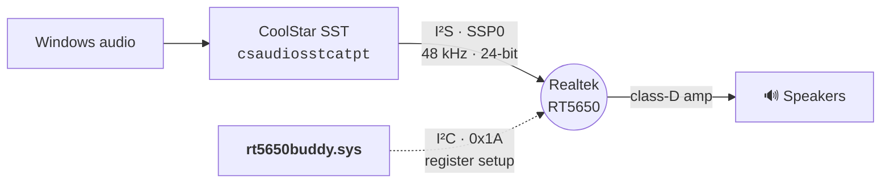

<div align="center">

# 🔊 rt5650-buddy

**Bringing speaker audio to Windows on the Acer Chromebase 24**

A minimal KMDF driver that configures the Realtek **RT5650** codec on the Google *BUDDY* board (Broadwell) over I²C.

[](https://github.com/itsbeko/rt5650-buddy/actions/workflows/build.yml)
[](LICENSE)
[](#-installation)
[](https://learn.microsoft.com/windows-hardware/drivers/wdf/)

**English** · [Français](README.fr.md)

</div>

---

## 📖 Table of contents

- [Why](#-why)
- [How it works](#%EF%B8%8F-how-it-works)
- [Status](#-status)
- [Installation](#-installation)
- [Building](#%EF%B8%8F-building)
- [Troubleshooting](#-troubleshooting)
- [Uninstalling](#%EF%B8%8F-uninstalling)
- [Credits](#-credits)
- [License](#-license)

## 💡 Why

Once you put Windows on a Chromebase 24, the CoolStar SST driver gets the Intel audio DSP running. The speakers still stay silent, because nothing on Windows sets up the **RT5650 codec** that sits between the DSP and the speakers. This driver fills that gap: it brings the codec up and opens the path to the speakers each time the device powers on.

## ⚙️ How it works



| Component | Role | Driver |
|---|---|---|
| Intel SST DSP (Broadwell, SSP0) | Moves audio samples over I²S | [CoolStar SST](https://coolstar.org/chromebook/windows-install.html), I²S *provider*, 2 ch, 24 MHz MCLK |
| Realtek RT5650 (ACPI `10EC5650`, I²C `0x1A`) | DAC + class-D speaker amplifier | **rt5650buddy** |

`rt5650buddy` never touches audio data. On every **D0 entry** it runs this init sequence over I²C:

1. **Identify:** read register `0xFF` and expect `0x6419`.
2. **Reset**, then the vendor init sequences (private registers).
3. **Bias:** OFF → STANDBY → ON.
4. **Clocks:** PLL1 turns the 24 MHz MCLK into ≈ 24.576 MHz, which becomes SYSCLK.
5. **I²S1:** slave mode, 24-bit, 48 kHz.
6. **Routing:** DAC L1/R1 → speaker mixer → SPKVOL → class-D amp.

On **D0 exit**, it turns the amp off and mutes the speakers.

Register values are ported from the Linux drivers [`rt5645.c`](https://github.com/torvalds/linux/blob/master/sound/soc/codecs/rt5645.c) (which also handles the RT5650) and [`bdw-rt5650.c`](https://github.com/torvalds/linux/blob/master/sound/soc/intel/boards/bdw-rt5650.c).

## 📊 Status

| Feature | |
|---|:---:|
| Internal speakers | ✅ |
| Headphone jack | ❌ |
| Jack detection | ❌ |
| Internal microphone | ❌ |
| Hardware volume control | ❌ *(fixed at ~0 dB, Windows volume still works)* |

## 📦 Installation

> [!WARNING]
> The driver is signed with a **test certificate**, so Windows must run in **test mode**. It is kernel-mode code: use it at your own risk.

**Prerequisite:** the [CoolStar SST driver](https://coolstar.org/chromebook/windows-install.html) is installed and its device starts without errors.

**1. Download** the `rt5650buddy` artifact from the [latest successful build](https://github.com/itsbeko/rt5650-buddy/actions/workflows/build.yml) and unzip it. It contains `rt5650buddy.sys`, `.inf`, `.cat` and `pont-test.cer`.

**2. Enable test signing**, then reboot:

```powershell
bcdedit /set testsigning on
```

**3. Trust the test certificate.** Run this in an elevated PowerShell:

```powershell
Import-Certificate -FilePath .\pont-test.cer -CertStoreLocation Cert:\LocalMachine\Root
Import-Certificate -FilePath .\pont-test.cer -CertStoreLocation Cert:\LocalMachine\TrustedPublisher
```

> [!NOTE]
> Each CI build generates a **new** certificate. Import the `.cer` that comes with the build you install.

**4. Install the driver:**

```powershell
pnputil /add-driver .\rt5650buddy.inf /install
```

You should now hear sound from the speakers. 🎉

## 🛠️ Building

<details>
<summary><b>With GitHub Actions</b> (recommended)</summary>

<br>

Every push and pull request triggers [`build.yml`](.github/workflows/build.yml). The workflow:

1. builds the driver with MSBuild on `windows-2022`;
2. creates a self-signed code-signing certificate;
3. signs `rt5650buddy.sys`, generates and signs the `.cat` catalog;
4. uploads everything as the `rt5650buddy` artifact.

</details>

<details>
<summary><b>Locally</b></summary>

<br>

You need Visual Studio 2022, the Windows SDK and the WDK.

```powershell
msbuild rt5650buddy.vcxproj /p:Configuration=Release /p:Platform=x64
```

Signing is disabled in the project (`SignMode=Off`). Sign the output yourself, or reuse the steps from the workflow.

</details>

## 🩺 Troubleshooting

The driver writes its result into the device's registry key. Read it with:

```powershell
Get-ItemProperty "HKLM:\SYSTEM\CurrentControlSet\Enum\ACPI\10EC5650\*\Device Parameters" |
  Select-Object @{n='DeviceId';e={'0x{0:X4}' -f $_.DeviceId}},
                @{n='InitStatus';e={'0x{0:X8}' -f $_.InitStatus}},
                InitStep
```

| `InitStep` | `InitStatus` | Meaning |
|:---:|---|---|
| **37** | `0x00000000` | ✅ Everything is fine: the codec is fully configured |
| 0 | `0xC000009A` | No I²C resource in ACPI (wrong device, or missing `_CRS`) |
| 0 | other error | Could not open the I²C controller (is the Intel I²C / Serial IO driver installed?) |
| 1 | `0xC0000182` | The chip answered but is not an RT5650 (`DeviceId` ≠ `0x6419`) |
| 1 | other error | No answer on I²C at `0x1A` |
| 2–13 | error | Failed during reset / init sequences |
| 14–17 | error | Failed while powering up bias |
| 18–22 | error | Failed configuring PLL / clocks |
| 23–24 | error | Failed configuring the I²S interface |
| 25–29 | error | Failed on digital power / routing |
| 30–37 | error | Failed on speaker path / amplifier |

> [!TIP]
> If `InitStep` is 37 and the speakers are still silent, the codec side is fine. Look at the SST driver instead: check that the stream is actually running and that MCLK is enabled.

## 🗑️ Uninstalling

```powershell
pnputil /enum-drivers | Select-String -Context 1,4 rt5650buddy   # find the oemXX.inf name
pnputil /delete-driver oemXX.inf /uninstall
bcdedit /set testsigning off                                     # optional, then reboot
```

## 🙏 Credits

- **Realtek** and the Linux ALSA/ASoC maintainers, for the [`rt5645`](https://github.com/torvalds/linux/blob/master/sound/soc/codecs/rt5645.c) codec driver, the source of every register value here.
- **[CoolStar](https://coolstar.org/chromebook/)**, for the Windows SST driver that makes Broadwell audio possible in the first place.

## 📄 License

Released under the [GNU General Public License v2.0](LICENSE), the same license as the Linux driver the init sequences come from.
